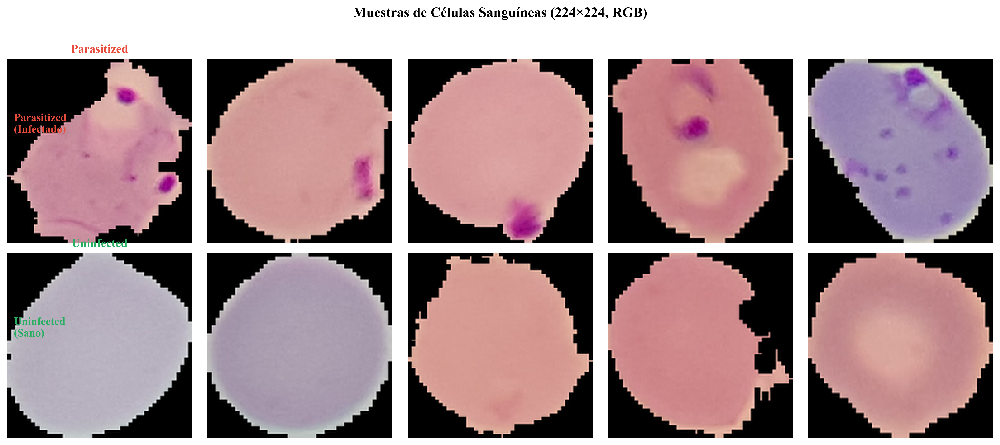
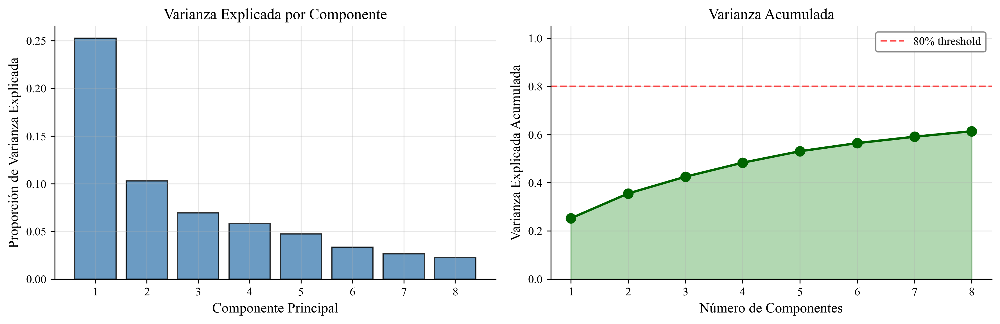
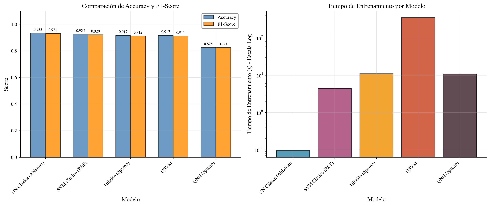
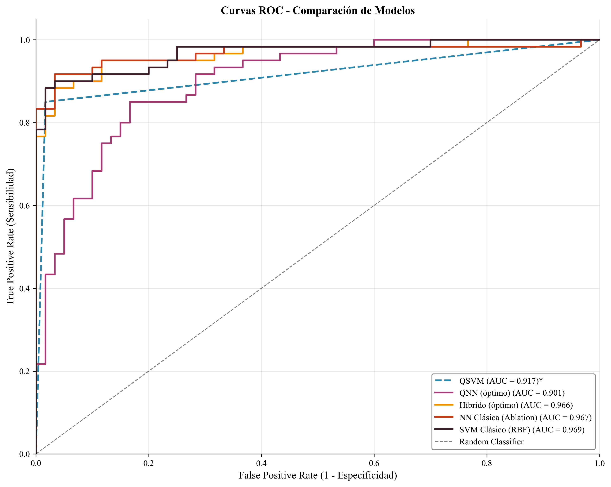
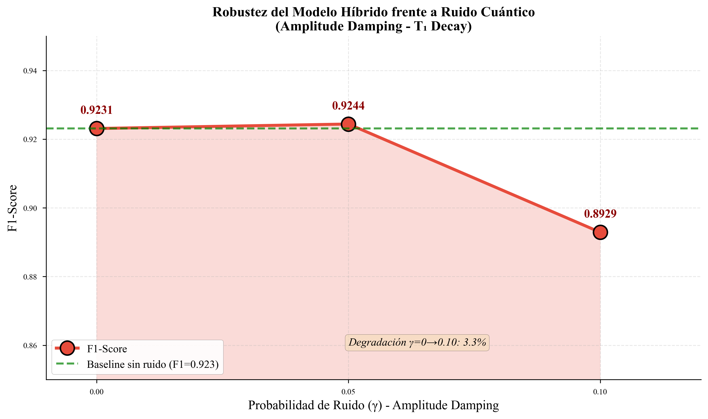
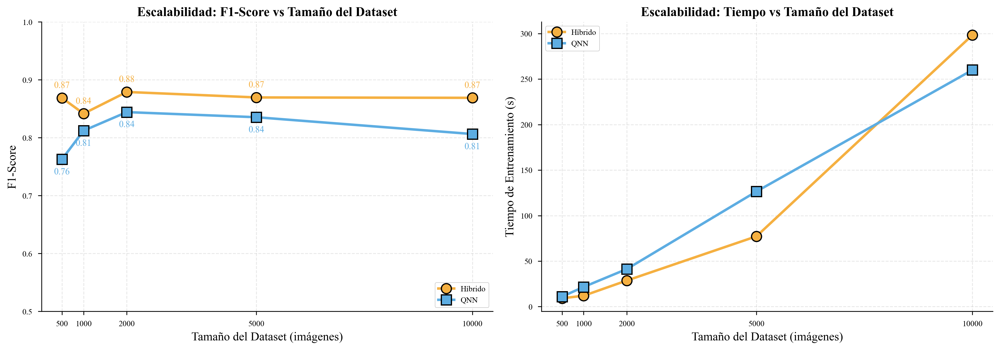
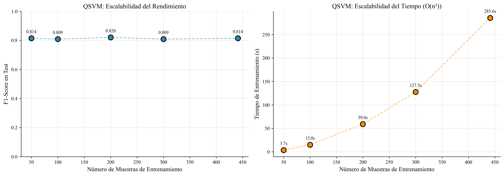

# Quantum Machine Learning for Malaria Detection

[](https://www.python.org/downloads/)
[](https://pennylane.ai/)
[](https://pytorch.org/)
[](https://opensource.org/licenses/MIT)

A comprehensive study comparing **Quantum Machine Learning** approaches against classical methods for biomedical image classification. This project uses the NIH Malaria Cell Images dataset to evaluate Quantum Support Vector Machines (QSVM), Quantum Neural Networks (QNN), and Hybrid Classical-Quantum architectures.

## Overview

Malaria diagnosis traditionally requires manual microscopic examination of blood smears—a labor-intensive process prone to human error. This project explores whether quantum computing can enhance automated malaria detection by leveraging the exponentially large Hilbert space for pattern recognition.

### Key Contributions

- **Transfer Learning Pipeline**: ResNet18 embeddings + PCA for efficient quantum encoding
- **Multiple Quantum Approaches**: QSVM, pure QNN, and Hybrid architectures compared
- **Noise Robustness Analysis**: Amplitude Damping simulation for NISQ hardware evaluation
- **Scalability Study**: Performance analysis across dataset sizes (500 to 10,000 images)

## Dataset

The **NIH Malaria Cell Images** dataset contains 27,558 cell images classified as:
- **Parasitized**: Infected with *Plasmodium* parasites
- **Uninfected**: Healthy blood cells


*Sample blood cell images from the NIH Malaria dataset (224×224 RGB)*

## Methodology

### Pipeline Architecture

```
┌─────────────────┐     ┌─────────────────┐     ┌─────────────────┐     ┌─────────────────┐
│  Blood Cell     │     │   ResNet18      │     │      PCA        │     │    Quantum      │
│  Images         │ ──► │   Embeddings    │ ──► │   (8 comp.)     │ ──► │   Classifier    │
│  (224×224×3)    │     │   (512-D)       │     │   [0, π]        │     │   (8 qubits)    │
└─────────────────┘     └─────────────────┘     └─────────────────┘     └─────────────────┘
```

### Dimensionality Reduction

PCA reduces the 512-dimensional ResNet embeddings to 8 components for quantum encoding via Angle Embedding.


*Principal Component Analysis: 8 components capture ~61% of the variance*

### Models Compared

| Model | Architecture | Qubits | Description |
|-------|--------------|--------|-------------|
| **QSVM** | Quantum Kernel + Classical SVM | 8 | Fidelity-based kernel in Hilbert space |
| **QNN** | Pure quantum circuit | 8 | StronglyEntanglingLayers + Hermitian measurement |
| **Hybrid** | Classical → Quantum → Classical | 8 | Linear + VQC + Linear layers |
| **Classical SVM** | RBF Kernel SVM | - | Baseline for comparison |

## Results

### Model Performance Comparison


*Comparison of F1-Score across all models*

### Key Findings

| Model | Accuracy | F1-Score | Precision | Recall |
|-------|----------|----------|-----------|--------|
| **Hybrid (Optimal)** | 91.67% | 0.912 | 0.933 | 0.892 |
| SVM Classical (RBF) | 92.50% | 0.920 | 0.918 | 0.923 |
| QSVM | 91.67% | 0.911 | 0.981 | 0.850 |
| QNN (3 layers) | 87.50% | 0.867 | 0.867 | 0.867 |

### ROC Curves


*Receiver Operating Characteristic curves showing classification performance*

## Noise Robustness Analysis

Real quantum hardware suffers from decoherence. We simulated **Amplitude Damping** (T₁ relaxation) to evaluate model robustness:


*Hybrid model performance under quantum noise (Amplitude Damping)*

**Key Insight**: The hybrid model maintains >89% F1-Score even with 10% noise probability, demonstrating resilience for NISQ-era deployment.

## Scalability Analysis

We evaluated how models scale with increasing dataset sizes:


*F1-Score and training time across dataset sizes (500 to 10,000 images)*

### QSVM Computational Cost

The quantum kernel matrix computation scales as O(N²), making QSVM impractical for large datasets:


*QSVM kernel computation time grows quadratically with dataset size*

## Installation

### Prerequisites

- Python 3.10+
- CUDA-compatible GPU (optional, for faster training)

### Setup

```bash
# Clone the repository
git clone https://github.com/yourusername/Quantum-Fin-Classifier.git
cd Quantum-Fin-Classifier

# Create virtual environment
python -m venv venv
source venv/bin/activate  # On Windows: venv\Scripts\activate

# Install dependencies
pip install -r requirements.txt
```

## Usage

### Running the Notebook

```bash
jupyter notebook notebooks/DeteccionMalaria_UO293619.ipynb
```

The notebook will automatically:
1. Download the NIH Malaria dataset (~350 MB)
2. Extract ResNet18 features
3. Train and evaluate all models
4. Generate comparison figures

### Project Structure

```
Quantum-Fin-Classifier/
├── README.md
├── requirements.txt
├── minitorch.py              # Training utilities
├── notebooks/
│   └── DeteccionMalaria_UO293619.ipynb
├── figures/
│   ├── sample_images.png
│   ├── model_comparison.png
│   ├── roc_curves.png
│   └── ...
├── results/
│   └── results_comparison.csv
└── data/                     # Auto-generated (gitignored)
    └── cell_images/
```

## Technical Details

### Quantum Circuits

**Angle Embedding**: Each PCA component is encoded as a RY rotation:
```
|0⟩ ──RY(xᵢ)──► α|0⟩ + β|1⟩
```

**Variational Ansatz**: StronglyEntanglingLayers with Rot(φ,θ,ω) gates and cyclic CNOTs for entanglement.

### Hybrid Architecture

```python
model = nn.Sequential(
    nn.Linear(8, 8),      # Pre-processing
    nn.ReLU(),
    QuantumLayer(8),      # VQC with 8 qubits
    nn.Linear(8, 1),      # Post-processing
    nn.Sigmoid()
)
```

## References

1. Havlíček, V., et al. (2019). *Supervised learning with quantum-enhanced feature spaces*. Nature, 567, 209–212.
2. Cerezo, M., et al. (2021). *Variational quantum algorithms*. Nature Reviews Physics, 3, 625–644.
3. Schuld, M., & Petruccione, F. (2021). *Machine Learning with Quantum Computers*. Springer.
4. Bergholm, V., et al. (2018). *PennyLane: Automatic differentiation of hybrid quantum-classical computations*. arXiv:1811.04968.

## Author

**Alfredo Flórez de la Vega** - UO293619

University of Oviedo - Quantum Machine Learning Course

## License

This project is licensed under the MIT License - see the [LICENSE](LICENSE) file for details.

---

*This project was developed as part of a Quantum Machine Learning course, demonstrating the application of variational quantum circuits to real-world biomedical classification problems.*

